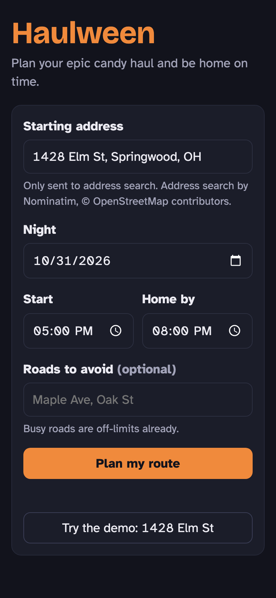
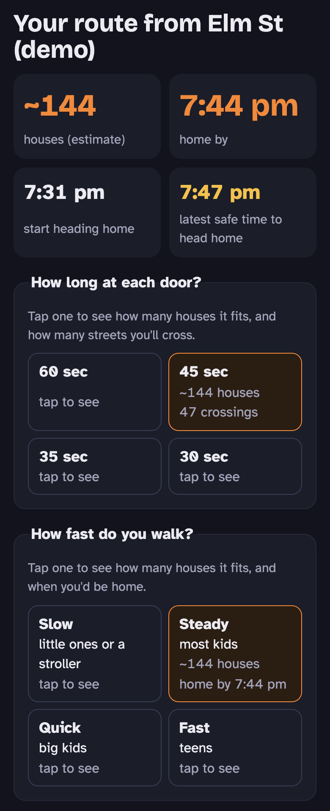
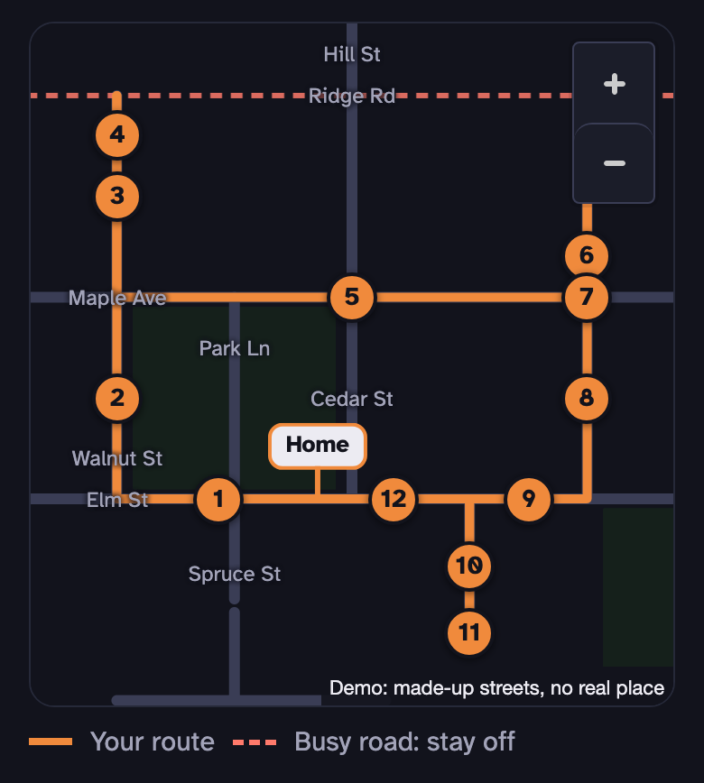
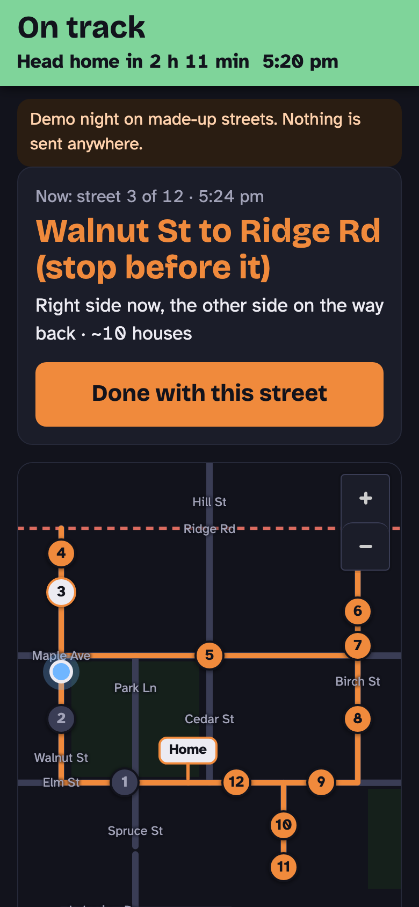

# Haulween

*Plan your epic candy haul and be home on time.*

Haulween plans one safe Halloween walking route from your front door that hits the most houses in the time your family has. It stays off busy roads, tells you when to head home, and gets everyone back on time.

**Try it:** https://haulween.vercel.app. Press "Try the demo" (or open https://haulween.vercel.app/?demo) to see a plan around 1428 Elm St in Springwood, a made-up neighborhood with made-up weather.

| Plan | Door time and pace | Map | Night Mode |
| --- | --- | --- | --- |
|  |  |  |  |

*From the demo, on a 390 px wide phone screen.*

## How to use it

1. **Plan.** Type your address, pick the night, when you'll start and when you need to be home, then tap Plan.
2. **Pick door time and pace.** Choose how long you'll spend at each door (60, 45, 35 or 30 seconds) and how fast your group walks (Slow, Steady, Quick or Fast). Each choice shows how many houses it fits, so you can compare before you pick.
3. **Roads to avoid.** Name any street you'd rather skip. Small typos and "St" vs "Street" are fine; Haulween says which road it matched, and asks when it isn't sure. Busy roads are already off the route.
4. **Start the night.** Night Mode shows the street you're on, whether you're on track, and when to turn around. Check off streets as you go.
5. **Replan from here.** Running late, or someone's tired? Tap Replan from here and Haulween rebuilds the rest of the route from where you are, still home on time.

## Plan ahead

- **Plan the night before, or early on Halloween.** The free street-map servers get busy on Halloween afternoon.
- **Once planned, the route is saved on your phone** with the street data it needs. Night Mode runs from that saved plan with no new lookups, and keeps working if you lose signal.
- **Open Night Mode before you head out.** Opening the page needs a connection; after that it doesn't.
- **If the street map doesn't come,** try again in a few minutes. Add `?debug` to the address to see what each server said.

## Jack, the AI guide (optional)

Jack can suggest a change in Night Mode when plans slip: skip a street, come home earlier, or walk slower. Haulween works fully without him.

- **Bring your own Claude API key.** Enter it in Settings. It's saved only on your phone (in this browser's storage) and sent only to Claude's API. "Forget my key" removes it.
- **What Jack sees:** the remaining street names, house counts and times, and what you type to him. Never your address, your home street or your coordinates.
- **You decide.** Every suggestion is checked by the app and shown to you first. Nothing changes until you tap "Use this".
- **Keep the cost capped.** In the Claude Console, set a monthly spending limit on your key and turn off auto-reload. Each question costs well under a cent.

## Privacy

No accounts, no analytics, no tracking. Your address, plans, settings and any API key stay in your browser.

| Service | What it gets |
| --- | --- |
| Nominatim (Photon as a backup) | The address you type, only when you press Search |
| Haulween's street relay (a Vercel function) | Your home point rounded to about 100 m, and the search radius. It logs nothing about requests. |
| Overpass.ch, through the relay | The same rounded point. It sees Vercel's internet address, not yours. |
| Private.coffee, only if the relay can't help | The same rounded point |
| Open-Meteo | Your home point rounded to about 1 km, and the night |
| OpenFreeMap | The map area you're looking at, as map tiles |
| Claude, only if you add a key | What's listed under Jack above |

Every service except Overpass.ch sees your internet address, as any website does. Haulween never uses overpass-api.de (its policy excludes apps on fast-deploy hosts) or any service operated in Russia.

## What it won't do

- **It can't tell you which houses give candy.** Nothing reliable tracks that. Look for porch lights.
- **House counts are estimates,** worked out from the length of each street minus parks, schools and corners. OpenStreetMap doesn't list every house.

## For builders

**Stack:** React, TypeScript and Vite, as a static site. MapLibre GL draws the map. Street data comes from OpenStreetMap through Overpass. The route logic in `src/route/` is plain TypeScript with no React or network calls, tested with Vitest.

**Run it locally** (Node 24 or newer, see `.nvmrc`):

```bash
npm install
npm run dev     # http://localhost:5173
npm test
npm run build
```

Add `?demo` to the local address to plan around Springwood with no network calls. Phones only allow GPS on `https`, so test Night Mode on a deployed copy.

**The street relay** (`api/streets.ts`) is the one server-side piece: a Vercel function that asks Overpass.ch with a key, because free public servers are overloaded and refuse fast-deploy apps. It takes only a rounded home point and a radius, builds its own query, and refuses anything else. Set the key as the `OVERPASS_KEY` environment variable in your host's settings. Never commit it; `.env*` files are git-ignored. Without a key the relay answers 501 and the app goes straight to the free servers, so a fork works with no setup.

**[CLAUDE.md](CLAUDE.md)** is the rules file. Haulween is built with Claude Code, and that file tells it (and any human contributor) how to build: the safety rules for routes, what may be sent where, and how to treat free services. Many of its rules come from real bugs, like a test route that cut through backyards. The product spec is [docs/build-brief.md](docs/build-brief.md).

## Credits

- Map data © [OpenStreetMap](https://www.openstreetmap.org/copyright) contributors (ODbL)
- Map tiles by [OpenFreeMap](https://openfreemap.org)
- Address lookup by [Nominatim](https://nominatim.org) and [Photon](https://photon.komoot.io)
- Weather and sunset by [Open-Meteo](https://open-meteo.com)
- Street data served by [Overpass.ch](https://overpass.ch) and [Private.coffee](https://private.coffee)

## License

MIT. Built in public with [Claude Code](https://claude.com/claude-code) by Pat Crowe ([@patcrowebar](https://github.com/patcrowebar)).
